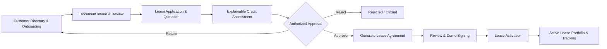
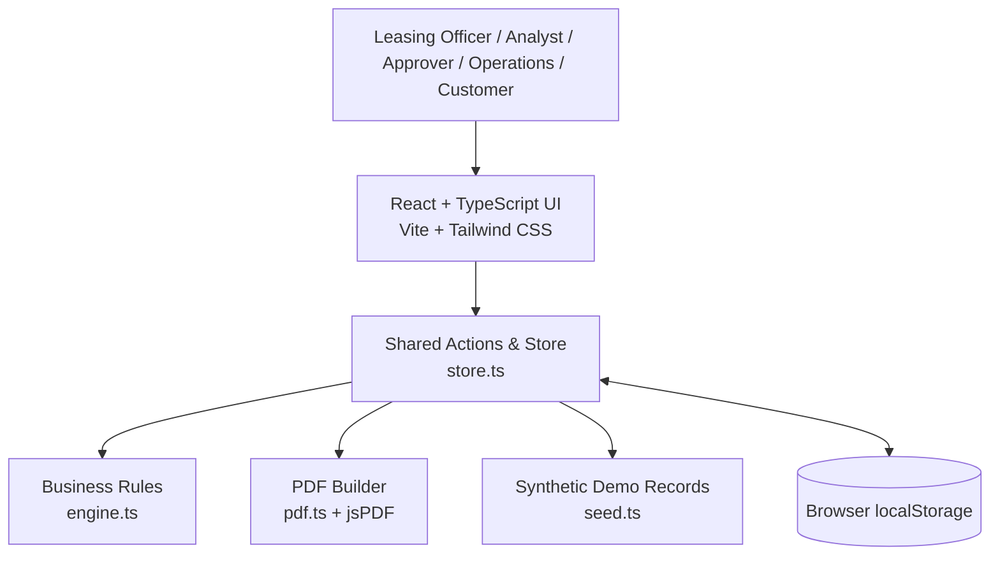
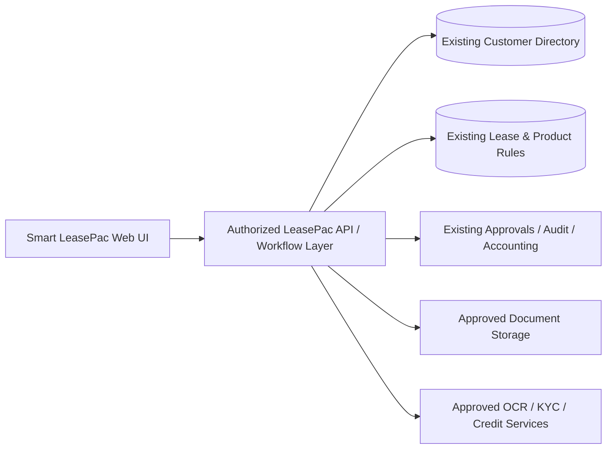

<!-- Smart LeasePac | Fintech Group Innovation Hackathon 2026 -->
<div align="center">

# 🚗 Smart LeasePac

### Intelligent Leasing & Workflow Automation for LeasePac

**Fintech Group Innovation Hackathon 2026**  
**Theme:** *Improving the Functionality and Usability of Existing Fintech Products*

[](#-the-hackathon-challenge)
[](#-solution-overview)
[](https://smart-leasepac-503-site.magicpatterns.app/)
[](https://react.dev/)
[](https://www.typescriptlang.org/)
[](https://vite.dev/)
[](https://tailwindcss.com/)
[](#-implementation-status--limitations)

**One application. One intelligent workflow. Faster leasing decisions.**

[🌐 Live Prototype](https://smart-leasepac-503-site.magicpatterns.app/) · [🎨 Magic Patterns Design](https://www.magicpatterns.com/os/7HeJzKHXns1K9EQX9gZwqx?file=eXwLMBTaXLs2t7HJGKhdST) · [✨ Features](#-features) · [🔄 Before & After](#-before--after) · [🏗 Architecture](#-architecture) · [🚀 Quick Start](#-quick-start) · [🎬 Demo](#-three-minute-hackathon-demo)

</div>

---

## 📌 Project at a Glance

| Field | Details |
| --- | --- |
| **Project name** | Smart LeasePac — Intelligent Leasing & Workflow Automation |
| **Existing product** | LeasePac |
| **Innovation** | AI-assisted onboarding, explainable credit assessment, approval workflow, agreement generation, and lease activation |
| **Category** | Existing-product enhancement; usability; process automation; decision support |
| **Creator / Developer** | **Gideon Rono** |
| **Event** | Fintech Group Innovation Hackathon 2026 |
| **Target users** | Leasing officers, credit analysts, approving managers, operations officers, supervisors, and customers |
| **Live prototype** | **https://smart-leasepac-503-site.magicpatterns.app/** |
| **Source** | This exported Magic Patterns React/TypeScript application; add your final public GitHub repository URL when published |
| **Demo video** | Add public or unlisted YouTube / Vimeo / Loom URL after recording (maximum 3 minutes) |
| **Delivery stage** | Functional browser-based prototype, not an integrated production LeasePac deployment |

> **Product positioning:** Smart LeasePac is an enhancement to **the existing LeasePac product**, not a replacement for its financial engine, customer master, accounting, or approval infrastructure. Production deployment would integrate with existing verified LeasePac data, configured lease products, institutional controls, and approved external services.

## 🏆 The Hackathon Challenge

The Fintech Group Innovation Hackathon 2026 challenges participants to improve the **functionality and usability of existing Fintech products** through practical new features, user-experience improvements, and automation. A strong submission must identify a clear customer or operational problem, demonstrate a practical working solution, compare the original and improved experience, and communicate realistic business value.

Smart LeasePac focuses on **LeasePac**, connecting previously separate customer-directory functions with a guided, end-to-end origination workflow. The application concentrates on **making an existing product better**, instead of creating an unrelated standalone financial platform.

### Submission requirements addressed

| Fintech requirement | Where to find it |
| --- | --- |
| Project name, product, improvement | Project at a Glance; Solution Overview |
| Problem statement (2–3 sentences) | Problem Statement |
| Before vs. after | Before & After; in-app comparison screen |
| Working prototype | Live Prototype; Demo Journey |
| Demo video ≤ 3 minutes | Three-Minute Hackathon Demo; link placeholder |
| Public code or shared prototype | Live link and exported source; public repository placeholder |
| README with run instructions | Quick Start; Project Structure |
| Tools, languages, libraries, AI | Verified Technology Stack; AI Transparency |
| Business benefit | Expected Impact & Measurement |

---

## ❗ Problem Statement

The existing LeasePac interface separates customer capture, customer approval, image upload, and customer details into different menu functions, requiring users to move between distinct screens. This can make customer onboarding and subsequent lease-processing handoffs harder to follow, especially when documentation, credit review, approval decisions, and application progress must be coordinated. **Smart LeasePac proposes a unified, guided workflow with assisted document handling, explainable credit assessment, role-aware approvals, agreement preparation, and lease tracking to improve usability, visibility, and operational efficiency.**

*The first observation is grounded in the supplied LeasePac screenshot. Additional operational pain points are improvement hypotheses, not independently verified production defects or measured customer complaints.*

## 💡 Solution Overview

**Smart LeasePac** introduces an intelligent workflow layer that connects the stages of a lease application:



**Design principles:** Familiar LeasePac identity; fewer disconnected steps; reusable customer data; explainable decision support; human approval authority; strong auditability; meaningful demo interactions; honest labeling of simulated integrations.

### Who benefits?

| User | Challenge addressed | New experience |
| --- | --- | --- |
| **Customer** | Limited visibility into progress | Simple application status tracker and missing-requirement visibility |
| **Leasing Officer / Maker** | Repeated capture and scattered tasks | Guided onboarding and application wizard |
| **Credit Analyst** | Reviewing affordability across multiple pieces of information | Consolidated financial context and reasoned risk indicators |
| **Approving Manager / Checker** | Tracking decisions and supporting evidence | Centralized workbench, decision history, and maker-checker separation |
| **Operations Officer** | Handover from approved application to active lease | Contract and activation checklist; active portfolio |
| **Supervisor** | Difficulty seeing the end-to-end pipeline | Pipeline dashboard, task visibility, and audit trail |

---

## 🔗 Live Prototype

### [Launch Smart LeasePac](https://smart-leasepac-503-site.magicpatterns.app/)

**Magic Patterns source design:** [Open the project design](https://www.magicpatterns.com/os/7HeJzKHXns1K9EQX9gZwqx?file=eXwLMBTaXLs2t7HJGKhdST)

The app has a top-bar **Demo role** selector, **Start Hackathon Demo**, and **Reset Demo** controls. It contains seeded, fictional records so reviewers can explore the experience without using real customer information.

**Suggested evaluator route:** Dashboard → Smart Onboarding → Lease Applications → AI Credit Assessment → Approval Workbench → Contract Generation → Active Leases → Before & After.

> **Demo notice:** The application uses browser-local seeded data and simulated external integrations. It does not access production LeasePac data or post real financial transactions.

---

## ✨ Features

### 1. 📊 Smart Leasing Dashboard

- Overview of the application pipeline and lease activity.
- Operational indicators for pending stages, approvals, and active leases.
- Recent activity and attention-required items.
- Navigation into the relevant customer and application workspaces.
- Dashboard figures derived from the prototype's shared in-browser state.

### 2. 👤 Guided Customer Onboarding & Directory

The prototype introduces a step-based onboarding journey informed by the original **Directory** screen, which includes *Capture Customer*, *Approve Customer*, *Image Uploader*, *Customer Details*, *Approve Customer Details*, and *Re-Edit Directory Details*.

- Supports **Individual, Joint Account, Group, and Business / Corporate** customer categories in its data model.
- Captures identity, contact, occupation/business, and financial information.
- Validates form fields and offers a review step before submission.
- Preserves entered details through the shared application store.
- Provides Directory-oriented customer records and verification actions.

### 3. 📄 Document Management & Simulated AI Extraction

- Document checklist based on customer type.
- Missing, uploaded, verified, and flagged status concepts.
- A sample **AI-assisted extraction** workflow for reviewing extracted fields.
- Reviewer control over extracted information before it is used.

**Important technical truth:** Current extraction is a **deterministic simulation** in `simulateExtraction()` inside `engine.ts`; no real OCR or identity-verification AI provider is connected. The document interface records file metadata/status in prototype state rather than implementing secure server-side document storage.

### 4. 🧾 Lease Application & Quotation Wizard

- Select a directory customer and enter asset/supplier details.
- Define purchase value, deposit, term, annual financing rate, repayment frequency, residual value, and arrangement fee.
- Preview amount financed, installment estimates, financing cost, and repayment schedule.
- Generate application-linked figures used in later stages.
- Support monthly and quarterly repayment frequencies in the current data model.

**Financial disclaimer:** Calculations are illustrative prototype estimates. Nonzero residual/balloon cases and production rounding/lease-product parity require validation before real financial use.

### 5. 🧠 Explainable Credit Assessment

- A **rule-based** score (0–100) and Low / Medium / High risk classification.
- Affordability indicators informed by declared income, existing debt, and estimated lease installment.
- Mandatory-document and flagged-document checks.
- Stability and repayment-term factors.
- A readable explanation of the assessment factors and recommended next action.
- Documented overrides in the prototype's audit history.

**No real credit bureau data or trained machine-learning scoring model is used.** The current rules are defined in `engine.ts`, and the recommendation is a demonstration of transparent decision support—not an automatically binding lending decision.

### 6. ✅ Role-Aware Approval Workbench

- Application queue, key application context, and decision history.
- Demo personas for Leasing Officer, Credit Analyst, Approving Manager, Operations Officer, and Supervisor.
- Approval, rejection, correction-return, and document-request actions.
- Recorded decision reasons and audit events.
- Maker-checker protections in the application-decision flow.
- Suggested routing from risk/amount rules.

**Scope note:** Suggested escalation routes are not the same as a fully integrated multi-level Credit Committee workflow. Prototype authorization controls are not a substitute for server-side access control or actual LeasePac permissions.

### 7. 📝 Lease Agreement Generation

- Draft agreement derived from customer, approved application, asset, and repayment information.
- Agreement preview and PDF download using `jsPDF`.
- Agreement versioning and demonstration review/signing statuses.
- Example contract language and repayment schedule.

**Legal disclaimer:** Agreements identify themselves as demonstration documents, use a fictional lessor, and are **not legally reviewed or digitally signed through a real e-signature provider**.

### 8. 🚗 Lease Activation & Active Portfolio

- Activation journey and application-to-lease conversion.
- Lease account reference, installment, schedule, payment/status display, and activity history.
- Overview of active lease records using seeded and newly created demo data.

**Control note:** The exported version contains an activation-screen verification bypass (`c.status === 'Verified' || true`) and does not consistently revalidate customer verification inside the central activation action. This must be corrected before treating activation safeguards as reliable. The app simulates activation; **no funds are posted**.

### 9. 🔎 Customer Application Status Portal

- Customer-facing perspective on application state and outstanding requirements.
- Reduced need to ask internal staff for basic status information (proposed benefit; not yet measured).
- Uses seeded prototype state rather than production login or customer authentication.

### 10. ⚖️ Before vs After & Guided Hackathon Demo

- In-app side-by-side comparison with the existing LeasePac Directory screenshot.
- Concise explanation of usability and process improvements.
- Proposed operational success metrics rather than made-up percentages.
- Guided demonstration steps, role switcher, and demo reset.

---

## 🔄 Before & After

The screenshot supplied with the project brief documents **existing LeasePac Directory Information**, its customer capture form and distinct directory menu entries. The following comparison distinguishes observed interface features from inferred operational limitations.

| Workflow area | Existing LeasePac / current screen | Smart LeasePac improvement |
| --- | --- | --- |
| Customer onboarding | Directory Information form with multiple data sections | Guided steps, validations, and completion review |
| Customer functions | Separate capture, approval, upload, and detail menu entries | Connected onboarding and application journey |
| Document handling | Separate Image Uploader appears in the menu | Document checklist, flags, simulated extraction, verification review |
| Credit assessment | Not evidenced in the supplied Directory screenshot | Consolidated, explainable prototype scoring and affordability view |
| Approvals | Separate customer approval functions visible | Application-specific workbench, role switcher, decision audit |
| Contract generation | Not evidenced in the supplied screenshot | Application-populated draft contract and PDF |
| Lease status | Not evidenced in the supplied screenshot | Pipeline dashboard and customer status tracker |
| Lease activation | Not evidenced in the supplied screenshot | Demo activation and active portfolio screens |

> **Evidence standard:** “Not evidenced” does **not** mean the original LeasePac lacks that functionality. Any broader existing-product comparison must be verified with a real user walkthrough before the judges are shown claims about the legacy system.

### What the upgrade aims to change

**Before:** An officer navigates separate areas to carry out related actions and establish application status.  
**After:** A guided application connects customer information, supporting documents, assessment, approvals, contract preparation, and activation into a coherent sequence.


*The referenced image is the existing product screenshot embedded in the prototype's comparison screen. External image availability depends on the hosting provider.*

---

## 🏗 Architecture

### Current exported prototype



There is **no backend API server, server database, production authentication service, real document storage service, or real external AI integration** in the current exported application.

### Suggested path to production integration (not implemented)



For a production enhancement, keep credit policy, financial calculations, workflow authorization, and audit enforcement on trusted server-side services. Confirm actual LeasePac integration points with the product engineering team instead of assuming endpoint names or database schemas.

---

## 🛠 Verified Technology Stack

The following inventory comes from the exported project's `package.json` and source files.

| Area | Technology | Purpose |
| --- | --- | --- |
| Frontend | React **18** (`^18.3.1`) | Component-based application |
| Language | TypeScript **5** (`5.9.3`) | Typed UI and domain entities |
| Tooling | Vite **8** (`8.3.2`) | Dev server and production bundle |
| Styling | Tailwind CSS **4** (`4.3.1`) | UI styling |
| Icons | Lucide React (`^0.441.0`) | Iconography |
| UI dependencies | Radix icons, Framer Motion, tailwind-merge | UI assets / motion / class merging |
| Routing dependency | React Router DOM (`^6.26.0`) | Router library in dependencies; main workflow uses its own shared route state |
| Date utilities | date-fns (`^3.6.0`) | Date utilities |
| PDF export | jsPDF (`^2.5.2`) | Agreements and quotation documents |
| State | Custom React external-store integration | Shared customer, application, and lease state |
| Persistence | Browser `localStorage` | Demo-only local persistence |
| Credit assessment | TypeScript deterministic rules | Explainable prototype score, not a live AI model |
| Document extraction | Simulated local adapter | Seeded example extraction, not OCR service |
| Prototype generation | Magic Patterns | Initial UI and code-export workflow |

**Do not include Node.js/Express, MongoDB, OpenAI, Gemini, or credit-bureau integrations as implemented technologies; they are not present in this export.** Node.js and npm are required to build/run the frontend locally.

## 🧠 AI Transparency, Safety & Human Oversight

The project demonstrates **AI-assisted workflow concepts** through explainable, locally simulated behavior. The current exported prototype does not invoke a hosted AI inference model.

| Capability | Current implementation | Real-world integration needed |
| --- | --- | --- |
| Document extraction | Deterministic sample extraction | Approved OCR/document AI and secure storage |
| Identity verification | Sample records and review statuses | Approved KYC/ID verification provider |
| Credit assessment | Explainable TypeScript rules | Validated institutional policy and approved external data |
| Risk routing | Rule-based recommendation | Actual approval matrix and maker-checker policy |
| Contract draft | Template + jsPDF | Legally approved terms and document controls |
| Signing | Demo state only | Approved e-signature / legal process |
| Customer messages | Status display in UI | Approved SMS/email/WhatsApp services |
| Lease activation | In-browser record transition | Core LeasePac authorization and accounting services |

Responsible implementation principles: obtain customer consent where required; minimize collected data; avoid sensitive-field exposure; validate explainability and fairness; allow human review; document overrides; enforce true permissions in the backend; avoid sending production customer records to unapproved services.

---

## 📁 Project Structure

```text
smart-leasepac/
├── index.html
├── package.json
├── vite.config.ts
├── README.md
└── src/
    ├── eXwLMBTaXLs2t7HJGKhdST.prototype/
    │   ├── index.tsx
    │   ├── index.css
    │   ├── metadata.json
    │   └── __mp-prototype-entry.tsx
    └── shared/smart/
        ├── App.tsx                # App shell, navigation, guided demo
        ├── Documents.tsx          # Document checklist and demo extraction UI
        ├── Schedule.tsx           # Repayment schedule component
        ├── engine.ts              # Calculations, credit rules, workflow guards
        ├── store.ts               # Browser-local state/actions/audit events
        ├── types.ts               # Shared customer/lease/domain types
        ├── seed.ts                # Synthetic records and demo users
        ├── pdf.ts                 # PDF quotation/contract generation
        ├── ui.tsx                 # Reusable UI primitives
        └── pages/
            ├── Dashboard.tsx
            ├── Directory.tsx
            ├── Onboarding.tsx
            ├── Applications.tsx
            ├── LeaseWizard.tsx
            ├── Assessment.tsx
            ├── Workbench.tsx
            ├── Contracts.tsx
            ├── ActiveLeases.tsx
            ├── Portal.tsx
            └── BeforeAfter.tsx
```

---

## 🚀 Quick Start

### Prerequisites

- Node.js and npm compatible with **Vite 8**. Check the engine requirements of the installed Vite release; use a recent supported Node.js LTS release.
- Git (if cloning a published repository).
- A modern Chromium-, Firefox-, or Safari-based browser.

### Run from the exported source ZIP

```bash
# 1. Extract the Magic Patterns ZIP into a directory.
cd smart-leasepac

# 2. Install dependencies listed in package.json.
npm install

# 3. Start the Vite development server.
npm run dev
```

Open the localhost URL printed by Vite (typically `http://localhost:5173`).

### Production build and preview

```bash
npm run build
npm run preview
```

Vite's build output is conventionally placed in `dist/`. Deploy the built static frontend using a supported static hosting provider. If deploying under a subpath, configure Vite's base path as appropriate.

**Available npm scripts in this export:** `dev`, `build`, and `preview`. There are **no `test` or `lint` scripts** in the supplied `package.json`; don't describe either as passing until tooling and tests have been added and run.

### Using the hosted demo

1. Visit **https://smart-leasepac-503-site.magicpatterns.app/**.
2. Select a demo user/role in the top bar.
3. Select **Start Hackathon Demo**, or navigate to a page in the sidebar.
4. Follow the customer → lease → assessment → approval → contract → activation workflow.
5. Use **Reset Demo** to restore the seeded records.

**Local storage warning:** Demo changes are stored in the current browser profile/device. Clearing site data or resetting the demo removes locally stored changes. Do not enter real personal or confidential financial information.

---

## 🧭 Guided End-to-End Demo Journey

The application's guided experience is designed to showcase a connected vertical slice, not isolated screen designs.

| Step | Demo role | Action | What the judges should notice |
| --- | --- | --- | --- |
| 1 | Leasing Officer (Maker) | Start an application / select customer | Existing customer data can be reused |
| 2 | Maker | Review documents and simulated extraction | Missing fields and assisted review are visible |
| 3 | Maker | Enter financing terms and generate quotation | Repayment schedule appears from current inputs |
| 4 | Maker or Credit Analyst | Run the rule-based credit assessment | Reasons, risk band, affordability, and next action are explainable |
| 5 | Maker | Submit for approval | Application enters the workbench |
| 6 | Approving Manager (Checker) | Review details and approve/return | Human decision and maker-checker separation |
| 7 | Authorized contract user | Generate and preview the agreement | Customer and financial details populate a PDF |
| 8 | Authorized contract user | Review and record demo signing | Contract state is explicitly tracked |
| 9 | Operations Officer | Activate eligible lease | Record enters active portfolio; no real posting |
| 10 | Presenter | Return to dashboard and Before & After | Shows product impact and narrative |

If a demonstration step is blocked by an application rule, choose the appropriate seeded case or correct the supporting record rather than bypassing the control.

---

## 🎬 Three-Minute Hackathon Demo

**Video requirement:** maximum **3 minutes**; publish an accessible public or unlisted YouTube, Vimeo, or Loom link.

| Timestamp | Scene | Voice-over focus |
| --- | --- | --- |
| **0:00–0:20** | Existing LeasePac screenshot and Before & After | Introduce the separated Directory functions and proposed guided workflow |
| **0:20–0:50** | Onboarding and documents | Show customer reuse, validation, and simulated document assistance |
| **0:50–1:25** | Quotation + credit assessment | Explain the affordability view, risk factors, and human-review recommendation |
| **1:25–1:55** | Approval Workbench | Switch roles and show the authorized decision trail |
| **1:55–2:30** | Agreement generation | Produce and preview the populated demonstration PDF |
| **2:30–2:48** | Activation and updated portfolio | Show continuity from approved application to active lease |
| **2:48–3:00** | Impact and closing | Emphasize functionality, usability, and practical integration potential |

**Demo video:** `ADD_PUBLIC_OR_UNLISTED_VIDEO_URL`

### Suggested closing statement

> “Smart LeasePac improves the product we already have. It connects onboarding, assessment, approval, contract preparation, and lease tracking into one guided journey—keeping officers in control while reducing avoidable handoffs and making each next action visible.”

---

## 📈 Expected Impact & Measurement

These are **proposed pilot measurements**, not observed results of the current application.

| KPI | Proposed measurement | Expected direction |
| --- | --- | --- |
| Application turnaround | Elapsed time from application start to approval/activation | ↓ Lower |
| Manual data-entry effort | Repeated fields entered per application | ↓ Lower |
| Document rework | Share of applications returned for missing documents | ↓ Lower |
| Credit-review preparation | Time to prepare risk and affordability review | ↓ Lower |
| Approval turnaround | Submission-to-decision duration | ↓ Lower |
| Customer status inquiries | Inquiries per application | ↓ Lower |
| Contract preparation | Approval-to-draft time | ↓ Lower |
| Application completion | Started applications reaching valid submission | ↑ Higher |
| Audit visibility | Traceable application actions and decision reasons | ↑ Higher |

### Practical pilot approach

1. Confirm current LeasePac steps with onboarding and leasing operations users.
2. Establish baseline times, rework rates, and manual touchpoints.
3. Run a controlled pilot with synthetic or appropriately authorized test data.
4. Compare equivalent application cases under the old and guided workflows.
5. Review security, calculation parity, customer outcomes, and exception handling before expanding deployment.

---

## 🧪 Testing & Acceptance Checklist

The source includes implementation logic for the main flows, but the supplied export does not establish passing automated tests or a verified production-grade release. Before the final live demonstration, verify:

- [ ] `npm install` and `npm run build` complete successfully.
- [ ] Dashboard, directory, onboarding, applications, credit, approvals, contracts, active leases, portal, and before/after pages open.
- [ ] Data entered in a wizard remains available on subsequent steps.
- [ ] Incomplete onboarding is blocked or clearly flagged.
- [ ] Document statuses accurately distinguish simulated from real verification.
- [ ] Affordability and score results change when relevant financial inputs change.
- [ ] Credit assessment becomes stale/requires re-run when important inputs change.
- [ ] Zero-rate, nonzero-residual, quarterly, and boundary-value schedules reconcile.
- [ ] A maker cannot approve their own application.
- [ ] Every rejected, returned, or overridden decision records an appropriate reason.
- [ ] Approval-routing messaging matches actually enforced approval stages.
- [ ] Contract preview and PDF include the correct approved terms.
- [ ] Returning a contract invalidates any superseded activation eligibility.
- [ ] Activation requires a verified customer, valid approvals, and signed-demo agreement in **central business logic**.
- [ ] An activated lease appears in the active portfolio and dashboard.
- [ ] Reset Demo restores the original seeded data.
- [ ] A complete demonstration can be recorded in under three minutes.

### Known issues to resolve before production or a control-focused demo

1. **Activation verification bypass** in the current active-lease UI; reinforce verification inside centralized actions.
2. **Residual/balloon schedule treatment** needs correction and reconciliation testing.
3. **Authorization hardening:** certain updates and state mutations need centralized role/transition checks.
4. **Assessment freshness:** changing material financial/document inputs should trigger reassessment.
5. **Committee approval parity:** displayed approval routes must not imply an implemented multi-level authorization chain.
6. **Document storage:** the current file workflow does not provide backend document persistence or true OCR.
7. **Automated tests:** add calculation, credit, permissions, transitions, and complete journey tests.

These disclosures reflect the **provided source export** and help distinguish prototype readiness from production readiness.

---

## 🔐 Security, Privacy & Production Readiness

- The app is a client-side demonstration. **Switching roles in the header is not real authentication.**
- `localStorage` is not a secure repository for customer PII, confidential documents, or institution credentials.
- Production use requires authenticated users, server-side authorization, role-scoped data access, audit retention, encryption, and secure document management.
- Real KYC, credit data, and contract signing require approved providers and lawful, consent-aware data handling.
- Financial formulas, approved lease products, interest conventions, rounding, residual terms, accounting entries, and approval thresholds must be aligned with the existing LeasePac implementation.
- AI recommendations must remain explainable, subject to human review, and checked against institutional policy and applicable regulation.

## 🗺 Product Roadmap

| Phase | Scope | State |
| --- | --- | --- |
| **1 — Prototype** | Guided onboarding, quotation, rule-based credit, approval UI, contract PDF, active portfolio, demo data | Present in export; hardening gaps listed above |
| **2 — Demo hardening** | Fix control gaps, financial reconciliation, state freshness, add automated tests | Pending |
| **3 — LeasePac integration** | Existing customer master, configurable lease products, authorization, accounting, audit services | Proposed |
| **4 — Approved integrations** | Real OCR, ID verification, credit data, secure file storage, messaging, signing | Proposed |
| **5 — Pilot and measurement** | Controlled user trials, usability feedback, before/after KPI evidence | Proposed |

---

## 🤝 Contribution & Development Workflow

The project is a hackathon prototype maintained by its creator. Contributions, reviews, and improvements can be organized through a public repository once published.

```bash
# Example local development workflow
git checkout -b feature/your-improvement
npm install
npm run dev
npm run build
```

When opening a change request, include what was changed, the affected pages/actions, how it was tested, and any impact on credit decisions, monetary calculations, permissions, contracts, or activation. Never commit real customer information, API keys, or private financial data.

## 📄 License

**No license file is included in the supplied Magic Patterns export.** All rights are reserved unless the creator explicitly publishes a license. If an open-source license is intended, add a reviewed `LICENSE` file and update this section; do not assume MIT licensing automatically.

## 👨‍💻 Creator & Attribution

**Created and developed by Gideon Rono**  
**Project:** Smart LeasePac — Intelligent Leasing & Workflow Automation  
**Event:** Fintech Group Innovation Hackathon 2026  
**Prototype platform:** [Magic Patterns](https://www.magicpatterns.com/)  
**Existing product enhanced:** LeasePac

No other individual developer or team-member attribution is included.

**Repository:** `ADD_FINAL_PUBLIC_GITHUB_REPOSITORY_URL`  
**Live application:** [smart-leasepac-503-site.magicpatterns.app](https://smart-leasepac-503-site.magicpatterns.app/)  
**Demo video:** `ADD_FINAL_PUBLIC_OR_UNLISTED_VIDEO_URL`

---

<div align="center">

### 🚗 Smart LeasePac

**One application. One intelligent workflow. Faster leasing decisions.**

*Building better products, together — Fintech Group Innovation Hackathon 2026.*

[Launch Prototype](https://smart-leasepac-503-site.magicpatterns.app/) · [View Magic Patterns Design](https://www.magicpatterns.com/os/7HeJzKHXns1K9EQX9gZwqx?file=eXwLMBTaXLs2t7HJGKhdST)

</div>
